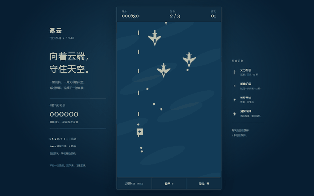

# 逐云 · 飞行作战



零依赖的浏览器纵向飞机大战。不用安装、不用构建，双击 `index.html` 即可开始。

## 操作

| 操作 | 键盘 | 触屏 |
| --- | --- | --- |
| 移动 | `WASD` / 方向键 | 在战场上拖动 |
| 射击 | 自动 | 自动 |
| 炸弹 | `Space` | 底部「炸弹」 |
| 暂停 | `P` / `Esc` | 底部「暂停」 |

## 规则

- 初始 3 条生命、2 枚炸弹；受伤后 2 秒无敌，护盾优先于生命消耗。
- 每存活 20 秒提升一个波次，敌机更快、更耐打；35 秒后出现首个空中堡垒。
- **连击系统**：2.5 秒内连续击杀积累连击，倍率 = 1 + floor(combo/10)，倍率影响分数；受伤或超时清零。
- 击落敌机时画面弹出得分飘字，倍率 ≥2x 的分数显示为金色。
- 击落敌机有概率掉落补给：火力升级、护盾、维修、炸弹，均有上限。
- 最高分保存在浏览器本地；隐私模式下保存失败不影响游玩。

## 目录

```text
plane/
├── index.html        页面结构、开始与结算遮罩
├── css/style.css     驾驶舱布局与移动端适配
├── js/entities.js    实体定义、固定逻辑坐标与碰撞
├── js/game.js        战斗规则、生成节奏与计分（无 DOM）
├── js/effects.js     Canvas 绘制、粒子与合成音效
├── js/main.js        输入、帧循环与界面同步
└── test/game.test.js Node 逻辑回归测试
```

## 测试

```bash
node test/game.test.js
```

测试直接加载 `js/entities.js` 与 `js/game.js`（两者用条件导出兼容浏览器和 Node），失败时退出码非 0。

## 备注

- 画面尺寸固定为 480×720 逻辑坐标，CSS 负责缩放；高 DPR 屏幕会按设备像素比提升清晰度（上限 2）。
- 帧间隔限制在 50ms，切回标签页不会瞬移；失焦或切后台会自动暂停。
- 音效使用 Web Audio 合成，首次点击或按键后解锁；可随时关闭。
- 系统开启「减少动态效果」时会关闭震屏并减少粒子，不影响玩法。
